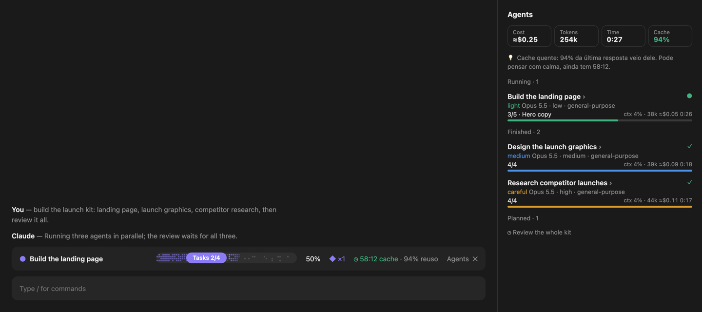

# Savvy Progress for Claude Code

A Claude Code mod that shows what Claude and its agents are doing, as it happens.




<sub>Sample data, drawn with the mod's own bar code.</sub>

- **Progress band** above the prompt: the current task, a pixel progress bar with a `Tasks 2/4` pill, the percent done and how many agents are running. While work runs, the done pixels twinkle, the ones just past the pill flicker on and a sheen sweeps across.
- **Agents pane** beside the chat: every subagent, running, finished or planned, with its model, effort, tool count, context use, tokens, cost and time. Click an agent to see its messages and tool calls live.
- **Prompt cache coach**: a countdown until the prompt cache goes cold, how much of the last request it served, and a suggestion for what to do: send the next message before it expires, or `/clear` / `/compact` when a cold cache would rewrite a large context.

Run `/savvy` to reopen the pane and the band.

## Install

At the prompt of a Claude Code terminal session:

```
/plugin install savvy-progress --marketplace lucasaraujonrt/claude-code-savvy-progress
```

Answer `y` to add the marketplace, then pick a scope.

From a shell:

```bash
claude plugin install savvy-progress --marketplace lucasaraujonrt/claude-code-savvy-progress
```

In the Claude desktop app, where `/plugin` does not run: click + next to the prompt box, then Plugins, Add marketplace with `lucasaraujonrt/claude-code-savvy-progress`, then Add plugin.

## Settings

- **Prompt cache TTL (minutes)**: `60` (default) or `5`. Set it to match your session's prompt cache: 5 minutes is the API default, 60 where the session uses the 1-hour cache.

## Notes

- Per-agent cost is an estimate from list prices (Opus $5/$25, Sonnet $3/$15, Haiku $1/$5 per million input/output tokens); the pane's total cost is the session's real figure.
- An agent's step counter fills from `TodoWrite`. Where subagents have no task list, the card shows its tool count and the last tool it used.

## License

MIT
